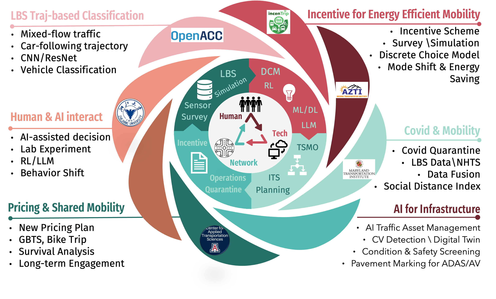

Research Scientist at the [Arizona Transportation Institute (AZTI)](https://azti.arizona.edu/){target="_blank"} and Researcher/Scientist at the [Center for Applied Transportation Sciences](https://appliedtransportation.arizona.edu/){target="_blank"}, Civil & Architectural Engineering and Mechanics, The University of Arizona.

Developing and applying data-driven, simulation-based, and AI-enabled frameworks to understand and improve how people, technologies, and transportation infrastructure interact, and how emerging mobility systems---including shared mobility, automation, electrification, and AI-assisted decision-making---affect travel behavior, system performance, safety, the environment, and broader social outcomes. My work connects three threads, shown in the roadmap below:

- **Human:** travel behavior and human--AI decision-making under incentives, pricing, and shared mobility, using discrete choice models, behavioral experiments, and large language models.
- **Technology:** agent-based and traffic simulation, trajectory-based classification of driving behavior in mixed traffic, and the safety, mobility, and environmental impacts of driver-assistance and electric vehicles.
- **Network & Infrastructure (AI for Infrastructure):** AI-enabled traffic asset management---computer-vision inventory, condition monitoring, and digital twins of signs, pavement markings, and other roadside assets for safety-driven maintenance---and closing the gap between pavement-marking condition and the perception needs of driver-assistance and automated vehicles.

::: {style="text-align:center; margin-top:1.5em;"}
**Research Roadmap**

{fig-align="center" style="max-height:500px;"}
:::

## Work Experience

::: {.experience-card}

**Research Scientist --- Arizona Transportation Institute (AZTI), University of Arizona** \
Research Areas: AI for Infrastructure, Statewide Transportation Research Programs \
[Mar 2026 -- Present · Tucson, AZ]{.meta}
:::

::: {.experience-card}

**Researcher/Scientist --- University of Arizona** \
Civil & Architectural Engineering and Mechanics, College of Engineering \
[Mar 2026 -- Present · Tucson, AZ]{.meta}
:::

::: {.experience-card}

**Postdoctoral Research Associate --- University of Arizona** \
Research Areas: Agent-based Model, Micromobility, Traffic Simulation \
[Jul 2024 -- Mar 2026 · Tucson, AZ]{.meta}
:::

::: {.experience-card}

**Postdoctoral Researcher --- Zhejiang University** \
Research Areas: Human-Computer Interactive Experiment, Agent-based Model \
[Jan 2024 -- July 2024 · Hangzhou, China]{.meta}
:::

::: {.experience-card}

**Senior Algorithm Engineer --- Alibaba Cloud Computing Co. Ltd.** \
Research Areas: Agent-based Model, Micromobility, Traffic Simulation \
[Jul 2021 -- Dec 2023 · Hangzhou, China]{.meta}
:::

::: {.experience-card}

**Research Assistant (Part-time) --- National Transportation Center, University of Maryland** \
Research Areas: Discrete Choice Model, Human Mobility, Travel Mode & Purpose Detection \
[Aug 2015 -- May 2021 · College Park, MD]{.meta}
:::

## Education

::: {.experience-card}

**Ph.D., Transportation Engineering --- University of Maryland** \
[Aug 2015 -- May 2021 · College Park, MD]{.meta} \
GPA: 3.89/4.0 · Coursework: Applied Machine Learning; Discrete Choice Analysis; Computational Statistics
:::

::: {.experience-card}

**M.S., Management Science & Logistics --- Tongji University** \
[Sep 2012 -- Jun 2015 · Shanghai, China]{.meta} \
GPA: 3.52/4.0 · Coursework: Probability & Statistics; Advanced Operations Research
:::

::: {.experience-card}

**B.S., Industrial Engineering --- Nanjing University** \
[Sep 2008 -- Jun 2012 · Nanjing, China]{.meta} \
GPA: 3.50/4.0 · Coursework: Operations Research; Data Structures & Algorithms; Probability & Statistics
:::

## Technical Skills

C++, Python, scikit-learn, TensorFlow, PyTorch, R, SQL, Docker, Ray

## Teaching Experience

Lecturer --- CE 462/562: Traffic Engineering and Operations, University of Arizona, Spring 2027 (upcoming).

Co-Teaching with [Dr. Mingfeng Shang](https://www.mingfengshang.com/){target="_blank"} --- CE 363: Transport Engineering and Pavement Design, University of Arizona, Fall 2025.

## Service

**Journal Reviewer:** Journal of Intelligent Transportation Systems (2024--); PLOS ONE (2021--); Transportation Research Record (2021--); Transportation Research Part C (2020--); Transportation Research Part A (2016--); System Engineering -- Theory & Practice (2015--)

**Conference Reviewer:** World Conference on Transport Research (WCTR, 2025--); IEEE ITSC (2025--); IEEE Intelligent Vehicles Symposium (2025--); HKSTS (2024--); Transportation Research Board (TRB, 2020--)

**Committees:** Arizona Transportation Institute Technical Advisory Committee Meetings (AZTI-TAC), participant/observer, 2025--present

## Contact

| | |
|---|---|
| **Location** | Tucson, Arizona, USA |
| **Email** | [zhaojun@arizona.edu](mailto:zhaojun@arizona.edu) |
| **LinkedIn** | [linkedin.com/in/jun-zhao-ua](https://www.linkedin.com/in/jun-zhao-ua){target="_blank"} |
| **Google Scholar** | [scholar.google.com](https://scholar.google.com/citations?hl=en&pli=1&user=KJ0F-MMAAAAJ){target="_blank"} |
